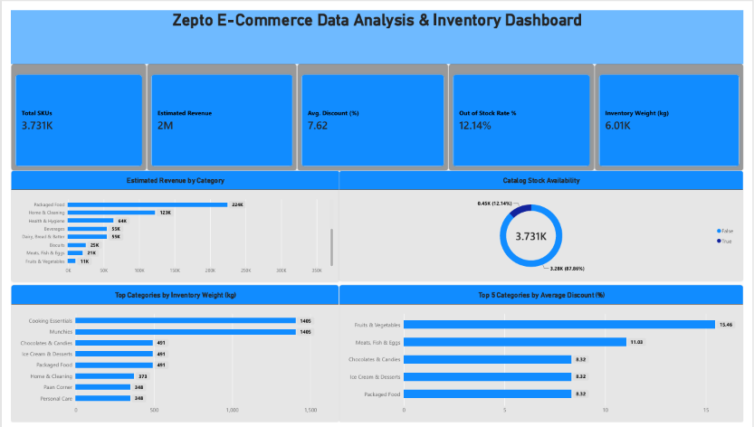

# Zepto E-Commerce Data Analysis & Inventory Dashboard

An end-to-end exploratory data analysis, data cleaning pipeline, and executive Business Intelligence dashboard built using **PostgreSQL** and **Microsoft Power BI**. This project evaluates product catalog pricing, promotional discounting, stock availability, and physical inventory weight across **3,731 cleaned SKUs** and **14 product categories**.

---

## Dashboard Preview



---

## Project Overview

Quick-commerce platforms rely on tight inventory control, accurate pricing tiers, and balanced promotional discounting to protect margins while minimizing stockouts. Using Zepto's product catalog dataset (`zepto_v2.csv`), this project:

1. **Audits and cleans raw catalog records** in PostgreSQL (removing invalid zero-MRP records and converting currency values from paise to Indian Rupees).
2. **Answers 8 core commercial and operational business questions** using SQL aggregations, conditional `CASE` segmentation, and unit-price calculations.
3. **Visualizes executive KPIs and category-level drivers** in a cohesive Power BI dashboard designed for rapid decision-making.

---

## Tech Stack & Tools

- **Database & Querying:** PostgreSQL (DDL, Data Cleaning, Aggregations, Conditional Logic)
- **Data Visualization & BI:** Microsoft Power BI Desktop (DAX Measures, Top-N Filtering, Executive KPI Cards)
- **Dataset:** `zepto_v2.csv` (3,731 active SKUs across 14 categories)

---

## Key Metrics & Analytical Findings

| Metric / Focus Area | Result | Operational & Commercial Takeaway |
| :--- | :--- | :--- |
| **Total Active SKUs** | **3,731** (from 3,732 raw) | 1 anomalous record with `MRP = 0` identified and removed during cleaning. |
| **Estimated Available Revenue** | **~₹2.0M+** | Driven primarily by high-turnover staples including **Cooking Essentials** (`₹0.34M`) and **Munchies** (`₹0.34M`), followed by **Paan Corner** and **Personal Care** (`₹0.27M` each). |
| **Catalog Stock Availability** | **87.86% In Stock** / **12.14% Out of Stock** | **3,278 SKUs** available vs. **453 SKUs** out of stock, highlighting restocking priorities among high-MRP items (`> ₹300`). |
| **Average Promotional Discount** | **7.62%** | **Fruits & Vegetables** (`15.46%`) and **Meats, Fish & Eggs** (`11.04%`) lead promotional discounting to accelerate perishable turnover. |
| **Total Inventory Weight** | **6,010 kg (6.01K kg)** | **Cooking Essentials** (`1,405 kg`) and **Munchies** (`1,405 kg`) account for nearly half of total physical warehouse weight. |

---

## SQL Workflow Structure

The PostgreSQL script (`Zepto Project.sql`) is organized into three structured phases:

1. **Phase 1 — Data Exploration:** Row count validation (`3,732` raw rows), `NULL` checks across critical attributes, category distribution (`14` categories), stock status breakdown, and multi-SKU product detection.
2. **Phase 2 — Data Cleaning:** Filtering corrupted `0` MRP entries (`3,731` valid records retained) and standardizing `mrp` and `discountedSellingPrice` from paise to INR (`/ 100.0`).
3. **Phase 3 — Business Analysis (8 Core Queries):**
  - **Q1:** Top 10 best-value SKUs by discount percentage.
  - **Q2:** High-MRP (`> ₹300`) products currently out of stock.
  - **Q3:** Estimated revenue (`discountedSellingPrice × availableQuantity`) by category.
  - **Q4:** Premium products (`MRP > ₹500`) with minimal discounts (`< 10%`).
  - **Q5:** Top 5 categories by average discount percentage.
  - **Q6:** Price-per-gram value ranking for products above `100g`.
  - **Q7:** Product weight tier segmentation (`Low < 1kg`, `Medium 1kg–<5kg`, `Bulk >= 5kg`).
  - **Q8:** Total available inventory weight (grams and kilograms) per category.

---

## Project Files

```text
├── README.md
├── Zepto Project.sql
├── zepto_dashboard.png
└── zepto_v2.csv
```

---

## Author

Abdullahi Abdi Hassan — Statistician & Data Scientist
- GitHub: https://github.com/Abdull223
- LinkedIn: https://www.linkedin.com/in/abdullahi-hassan-a7a98b39a
- Email: abdullahiabdihassan@gmail.com